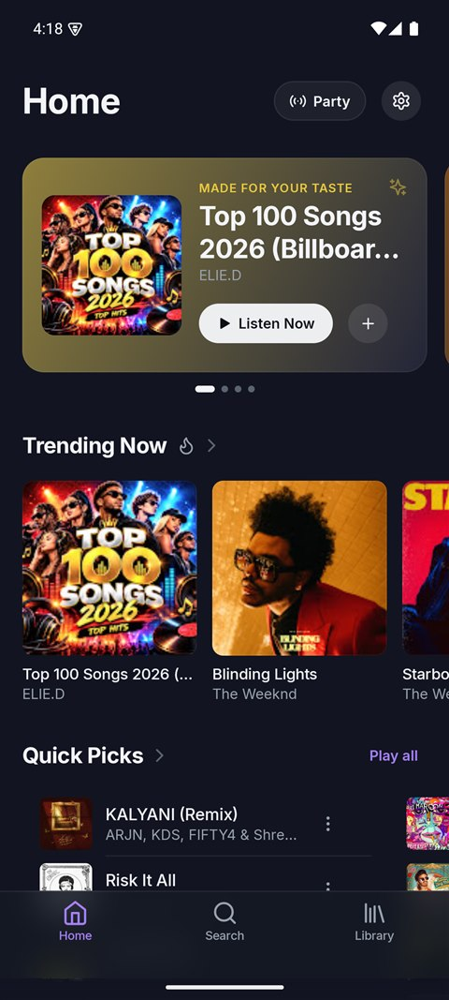
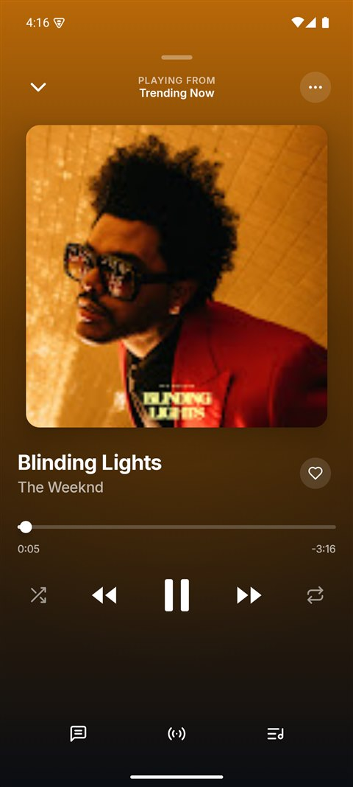
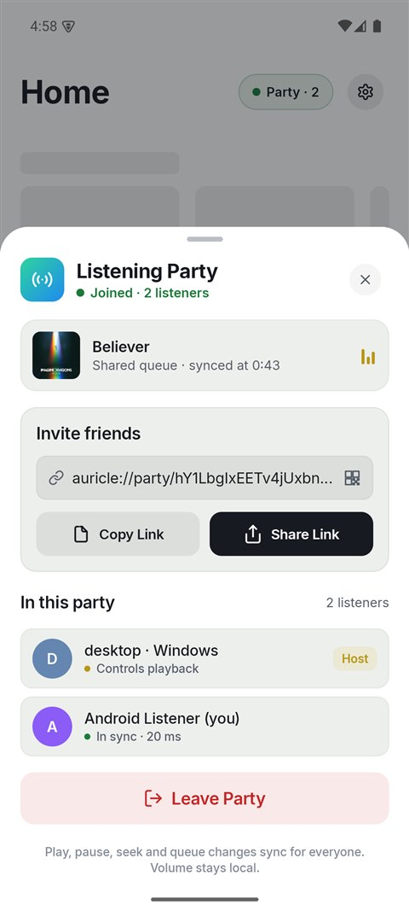
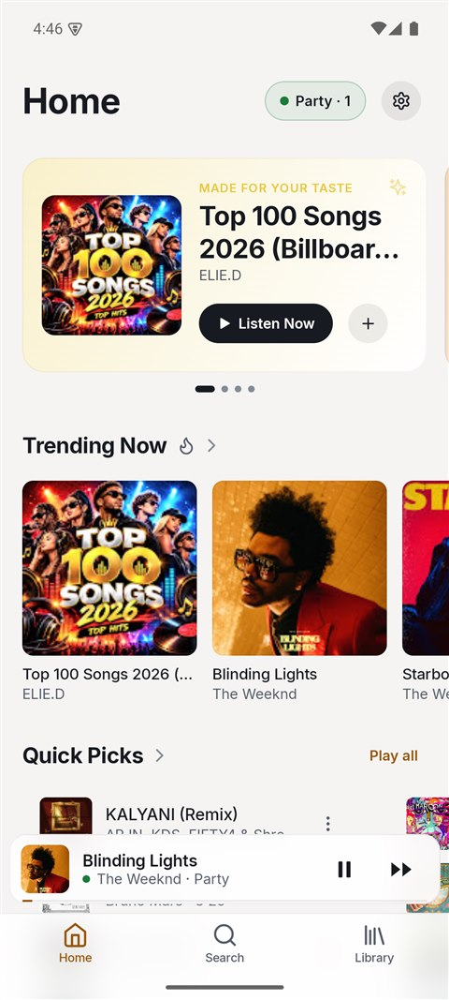
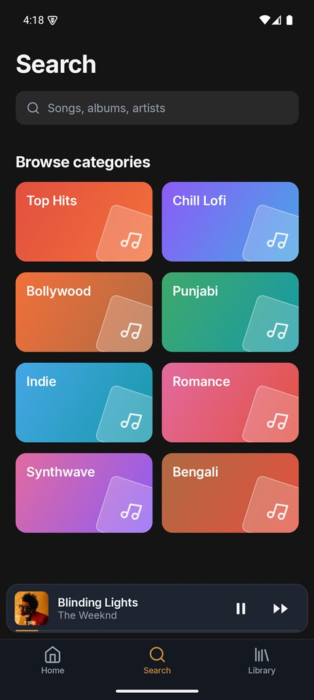
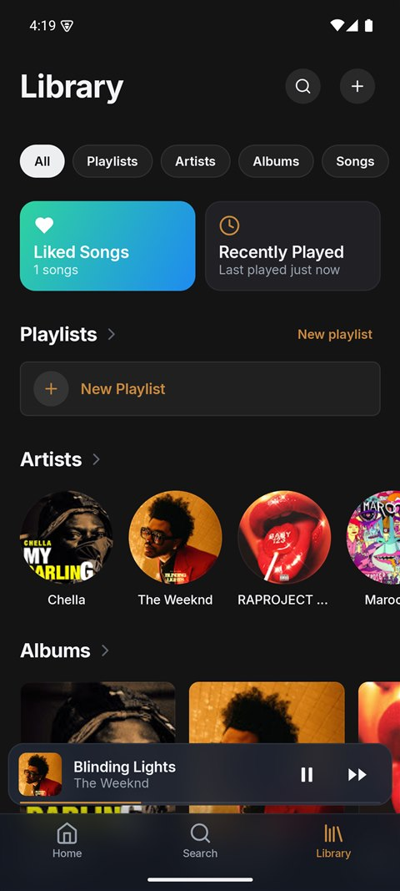
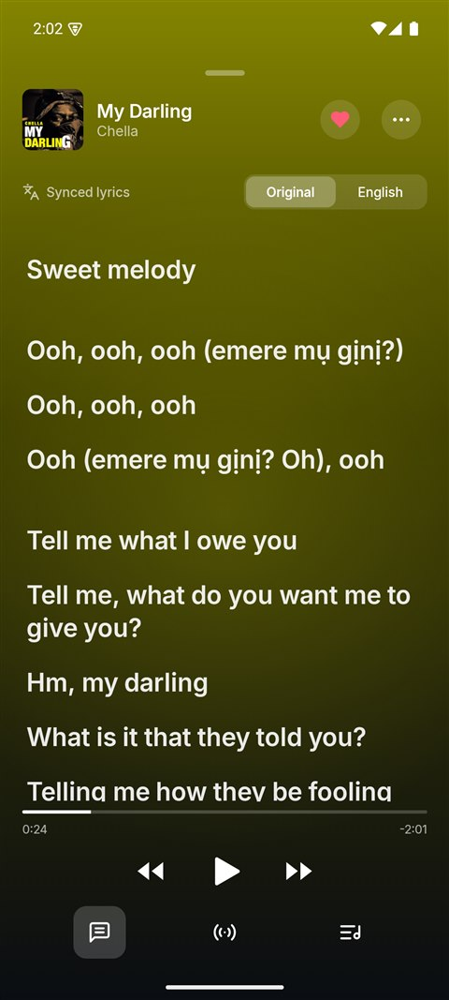
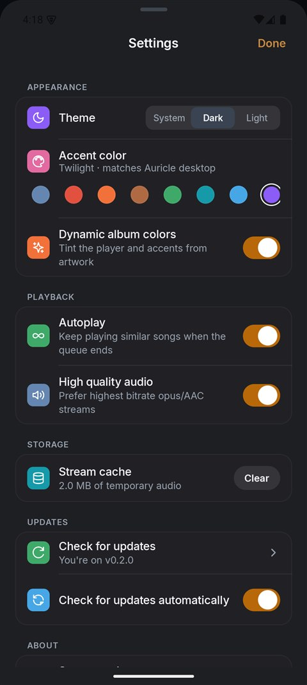

<div align="center">

# Auricle for Android

**A fast, native Android music player & cross-platform Listen Together companion for [Auricle](https://github.com/californiaAlmonds/auricle).**

Built with **Kotlin**, **Jetpack Compose**, **Media3 (ExoPlayer)**, and a **Rust** native core (`ytmapi-rs`, Innertube stream resolver, lyrics translation engine, and **Iroh 1.5 QUIC** peer-to-peer sync).

[](https://github.com/californiaAlmonds/auricle-android/releases/latest)
[-3FA96A?style=flat-square&logo=android&logoColor=white)](https://github.com/californiaAlmonds/auricle-android/releases/latest)
[](https://github.com/californiaAlmonds/auricle-android/releases/latest)
[](LICENSE)

[](https://sourceforge.net/projects/auricle/files/)

[Download Latest APK](https://github.com/californiaAlmonds/auricle-android/releases/latest) · [SourceForge Mirror](https://sourceforge.net/projects/auricle/files/) · [Windows Desktop App](https://github.com/californiaAlmonds/auricle) · [Contributing](CONTRIBUTING.md)

</div>

---

## Screenshots

<table>
  <tr>
    <td align="center"><br/><sub><b>Home (Dark + Dynamic Accent)</b></sub></td>
    <td align="center"><br/><sub><b>Now Playing (Artwork Tint)</b></sub></td>
    <td align="center"><br/><sub><b>Live Party (Android ↔ Windows)</b></sub></td>
    <td align="center"><br/><sub><b>Home (Light + Active Party)</b></sub></td>
  </tr>
  <tr>
    <td align="center"><br/><sub><b>Search & Browse Categories</b></sub></td>
    <td align="center"><br/><sub><b>Local Library & Playlists</b></sub></td>
    <td align="center"><br/><sub><b>Synced Lyrics (Original / English)</b></sub></td>
    <td align="center"><br/><sub><b>Settings & 10 Desktop Accents</b></sub></td>
  </tr>
</table>

---

## Highlights

- **Cross-Platform Listening Party (`Android ↔ Windows`):** Host or join synchronized listening sessions with a compact `auricle://party/...` invite link. Powered by encrypted **Iroh 1.5 QUIC P2P** with automatic NAT traversal and relay fallback — no accounts or central backend servers. Everyone shares real-time Play/Pause, Seek, Next/Previous, and Queue state with a 6-sample min-RTT clock filter, live participant list (`Host` badge, platform tags, and guest sync latency), and local volume control.
- **Desktop-Matched Design System & Dynamic Theming:** Dark, Light, and System modes paired with all **10 Auricle Desktop accent presets** (*Default Blue, Solar Red, Ember, Earth, Forest, Ocean, Sky, Twilight, Rose, Mono*), optional real-time album-art **Palette** accent extraction, bundled **Inter** typography, API 31+ `RenderEffect` frosted-glass chrome, shared-element artwork transitions, collapsible large titles, and Android 14+ predictive back gestures.
- **Immersive Now Playing:** Smooth 400 ms crossfading artwork-tinted gradient, sleek 4 dp scrubber, and in-place bottom switching between **Player**, **Up Next** (Shuffle / Repeat / Autoplay pills + haptic drag-to-reorder queue), **Party**, and **Lyrics**.
- **Original & Translated Lyrics:** Synced auto-scrolling lyrics with active-line emphasis and an instant **`Original | English`** switch providing Romanized pronunciation alongside line-by-line English meaning for non-Latin songs.
- **Full YouTube Music Browsing & Local Library:** Featured Hero Pager, Trending Now, horizontally paged Quick Picks, New Releases, instant search autocomplete, filtered results (`All`, `Songs`, `Albums`, `Artists`, `Playlists`), rich Album/Artist/Playlist detail pages, Liked Songs, Recently Played history, custom playlists, and rich Song Options (`Play Next`, `Add to Queue`, `Share`, `Go to Album`, `Go to Artist`).
- **Built-In Verified Updater:** Checks [GitHub Releases](https://github.com/californiaAlmonds/auricle-android/releases/latest) automatically (at most once every 24 h) or manually from **Settings → Updates**, selects the matching ABI APK (with universal fallback), verifies the download's **SHA-256 digest** before installing, and rejects/deletes corrupted files automatically.
- **Reliable Background & Lock-Screen Playback:** Full Android **Media3 (`MediaSessionService`)** integration with artwork notifications, lock-screen & Bluetooth controls routed through Party sync, `WAKE_MODE_NETWORK`, 6-hour stream URL cache, and automatic `NewPipeExtractor` / HLS fallback on `403` / `416` errors.

---

## Download & Install

Get the signed APK directly from **[GitHub Releases](https://github.com/californiaAlmonds/auricle-android/releases/latest)** or the **[SourceForge mirror](https://sourceforge.net/projects/auricle/files/)**:

| APK Artifact | Target Devices | Approx. Size |
| :--- | :--- | :---: |
| **`auricle-android-<ver>-arm64-v8a.apk`** *(Recommended)* | Modern 64-bit Android phones & tablets | ~16.5 MB |
| **`auricle-android-<ver>-x86_64.apk`** | Android emulators & x86_64 tablets / Chromebooks | ~17.9 MB |
| **`auricle-android-<ver>-universal.apk`** | Universal (`arm64-v8a` + `x86_64`) | ~29.9 MB |

- **Android 15+ Ready:** Built with R8 code/resource shrinking and 16 KB ELF page alignment (`useLegacyPackaging = false`).
- **Seamless Upgrades:** All official releases are signed with the same release key — install directly over previous versions (or update inside **Settings → Updates**) while keeping your library, playlists, and settings intact.
- **Verify Integrity:** Compare the file's SHA-256 checksum against the digest shown on the GitHub Release asset before sideloading.

> **Disclaimer:** Auricle is an independent, open-source client and is not affiliated with YouTube or Google.

---

## Architecture

| Layer | Directory / Files | Responsibilities |
| :--- | :--- | :--- |
| **Android UI & State** | `app/src/main/java/com/auricle/app/ui/` | Jetpack Compose Material 3 UI, `SharedTransitionLayout`, `AuricleAppTheme` + Inter font, API 31+ backdrop `BlurEffect` glass, screens & modal sheets |
| **Playback & Sync** | `app/src/main/java/com/auricle/app/playback/` | `AuriclePlaybackService` (`MediaSessionService`, `ForwardingPlayer`), `PlaybackController` (queue, Party poll/drift loop, `NewPipeFallbackExtractor`) |
| **In-App Updater** | `app/src/main/java/com/auricle/app/updater/` | `UpdateRepository` (GitHub Releases API, ABI selection, HTTPS host allowlist, streaming SHA-256 verification, `FileProvider` install flow) |
| **Local Persistence** | `app/src/main/java/com/auricle/app/data/` | Backwards-compatible `kotlinx.serialization` JSON stores (`settings.json`, `library_state.json`) & `MusicRepository` |
| **Rust Native Core** | `rust/src/` (`libauricle_core.so`) | Panic-guarded JNI bridge (`lib.rs`), `ytmapi-rs` catalog (`ytm.rs`), Innertube `VISIONOS`/`IOS` resolver + 6h cache (`stream.rs`), lyrics/Romanization (`lyrics.rs`), and the canonical Iroh 1.5 P2P engine (`party.rs`, wire-identical with Windows Auricle) |

---

## Building from Source

### Prerequisites

- **JDK 17+**
- **Android SDK** (`platforms;android-35`, `build-tools;35.0.0`, `ndk;27.2.12479018`)
- **Rust 1.91+** with Android targets:
  ```bash
  rustup target add aarch64-linux-android x86_64-linux-android
  ```
- **[`cargo-ndk`](https://github.com/bbqsrc/cargo-ndk):**
  ```bash
  cargo install cargo-ndk
  ```

### 1. Build the Rust JNI Libraries

```bash
cargo ndk -t arm64-v8a -t x86_64 -o app/src/main/jniLibs build --manifest-path rust/Cargo.toml --release
```

### 2. Run Unit Tests

```bash
# Rust core & Party state-machine tests
cargo test --manifest-path rust/Cargo.toml --release --lib

# Android settings migration & updater tests
./gradlew testDebugUnitTest
```

### 3. Build Release APKs

For a local debug-signed R8 release build:

```bash
./gradlew assembleRelease -PsplitApks=true -PallowDebugSignedRelease=true
```

For a production-signed release build:

```bash
export AURICLE_KEYSTORE_PATH=/path/to/auricle-release.jks
export AURICLE_KEYSTORE_PASSWORD=your_store_password
export AURICLE_KEY_ALIAS=auricle
export AURICLE_KEY_PASSWORD=your_key_password
./gradlew assembleRelease -PsplitApks=true
```

APKs are emitted under `app/build/outputs/apk/release/`.

---

## Contributing

Contributions follow the `feature/* → release/x.y.z → main` branch model. Please see [CONTRIBUTING.md](CONTRIBUTING.md) before opening a pull request.

## License

Licensed under the **GNU General Public License v3.0** (`GPL-3.0-only`). See [LICENSE](LICENSE) for full details.
